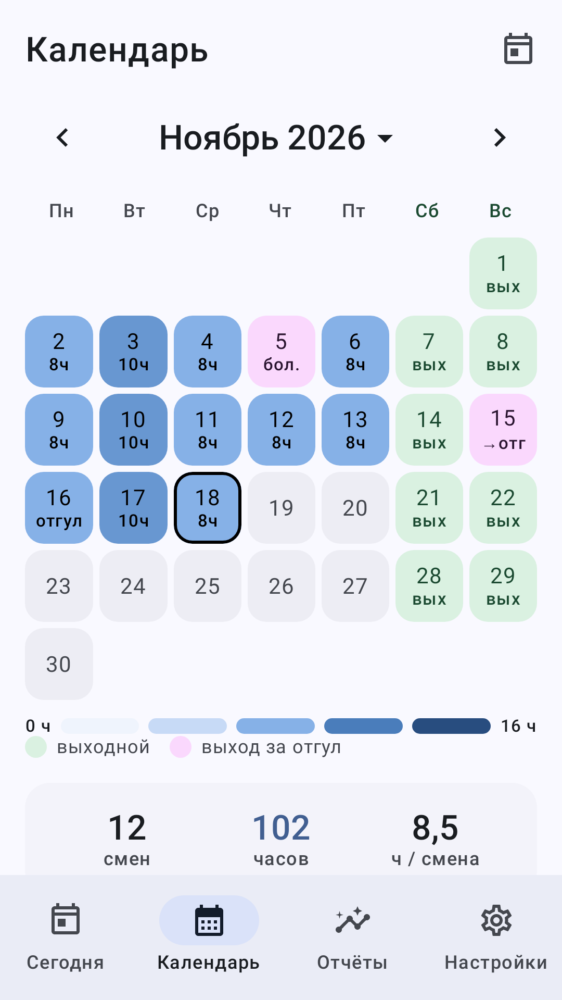
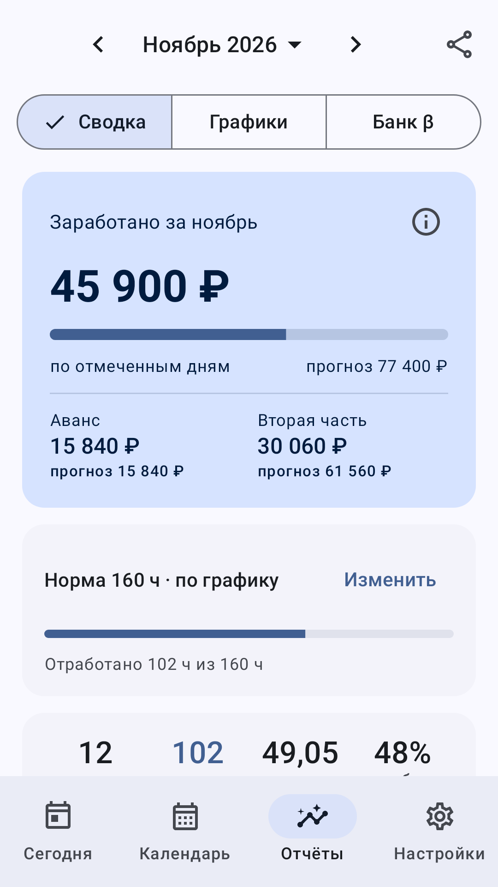

# Наряд

Личный журнал смен для Android. Считает выработку по выполненным операциям, а зарплату и аванс — по отработанным часам и вашим ставкам. Работает без интернета.

**Телефон · Android 8 и новее** — [Установить из RuStore](https://www.rustore.ru/catalog/app/ru.workorder) · [Скачать APK 4.3](https://github.com/Levug/android-workorder/releases/download/v4.3/WorkOrder-4.3.apk) 
**Часы · Wear OS** — [Скачать APK 4.2](https://github.com/Levug/android-workorder/releases/download/v4.2/WorkOrder-4.2-watch.apk) · [Подключить к телефону](docs/USAGE_GUIDE.md#часы-wear-os)

  
  
  

## Первая смена

В разделе «Сегодня» нажмите **«Записать часы»**. Для учёта нормо-часов добавьте операцию, норму времени на штуку и количество. В «Отчётах» укажите ставку. Там же можно сохранить итог месяца в PDF или CSV.

[Руководство](docs/USAGE_GUIDE.md) · [Перенос на новый телефон](docs/USAGE_GUIDE.md#резервная-копия-и-перенос-данных)

[История версий](CHANGELOG.md) · [Сборка проекта](docs/BUILD.md) · [Конфиденциальность](PRIVACY.md) · [Сообщить об ошибке](https://github.com/Levug/android-workorder/issues/new)
