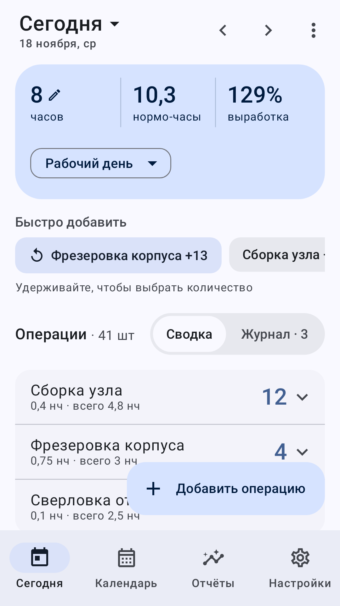

# Наряд

Учёт рабочих смен, выполненных операций и нормо-часов на Android. В конце месяца можно сверить выработку и расчёт зарплаты и сохранить отчёт.

**[Скачать 4.3 для Android](https://github.com/Levug/android-workorder/releases/latest)** · [Открыть в RuStore](https://www.rustore.ru/catalog/app/ru.workorder) · [Компаньон для Wear OS](docs/USAGE_GUIDE.md#часы-wear-os)

  
  
  

- Записывайте часы смены, добавляйте операции партиями и смотрите выработку за день.
- Отмечайте в календаре смены по графику 5/2 или 2/2, отгулы и больничные.
- Смотрите расчёт зарплаты и аванса, сохраняйте отчёты в PDF и CSV.
- Добавляйте виджеты на главный экран или вносите операции с часов Wear OS.

Приложение работает на Android 8 и новее. Данные хранятся на устройстве, учётная запись не нужна.

[Как начать](docs/USAGE_GUIDE.md) · [История изменений](CHANGELOG.md) · [Политика конфиденциальности](PRIVACY.md) · [Сообщить об ошибке](https://github.com/Levug/android-workorder/issues/new)

[Сборка проекта](docs/BUILD.md) · [Материалы RuStore](docs/RUSTORE.md)
