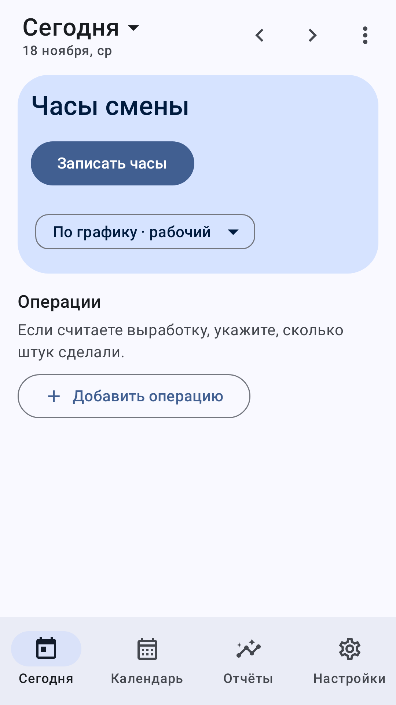
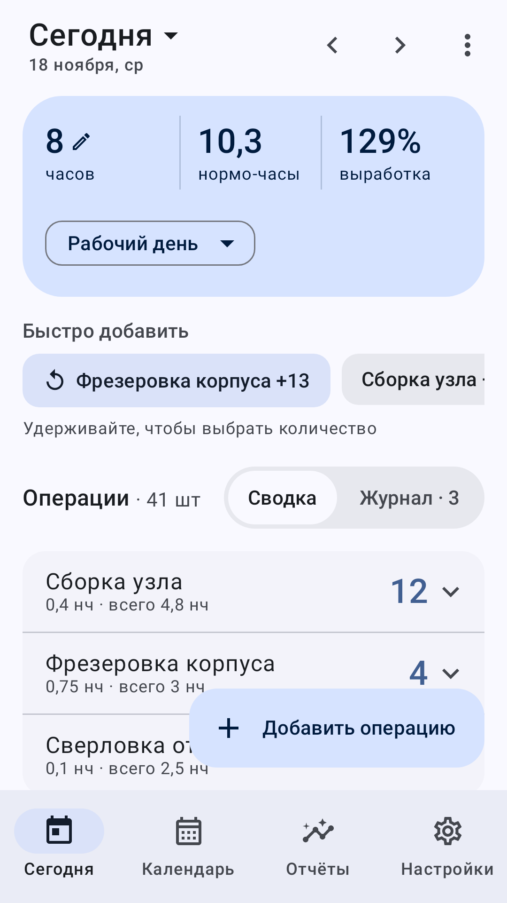
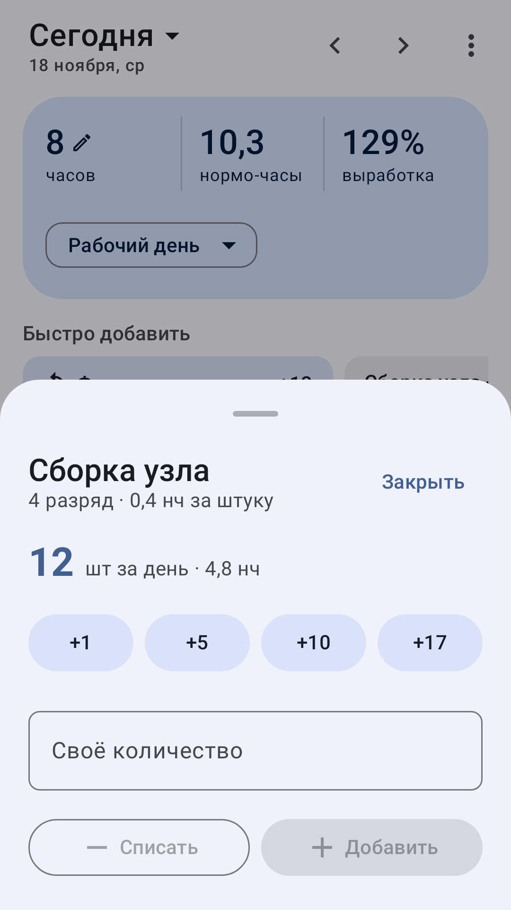
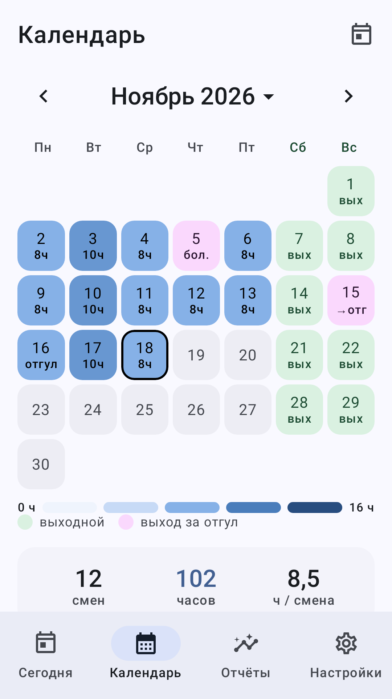
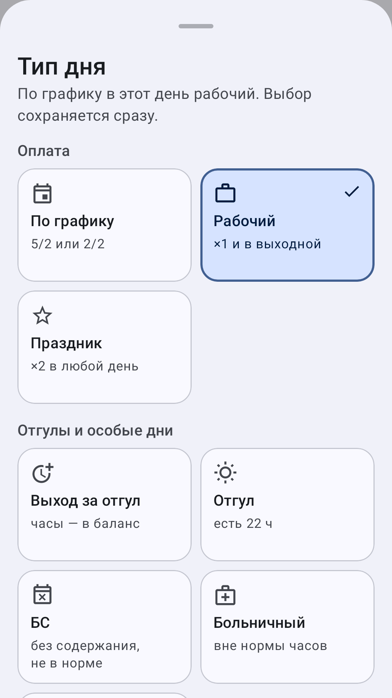
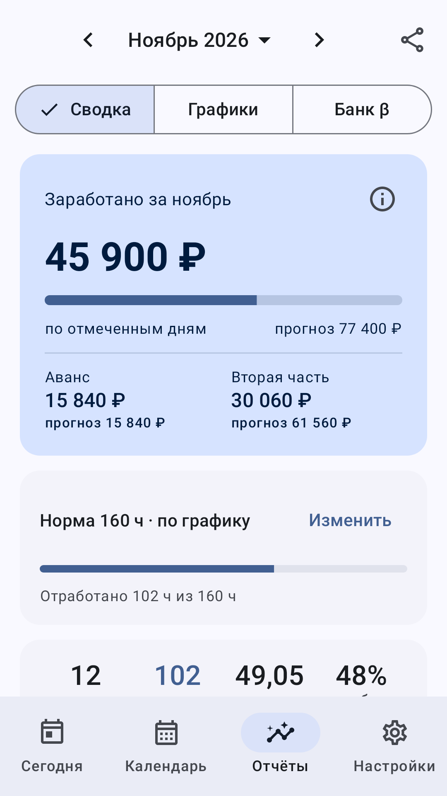
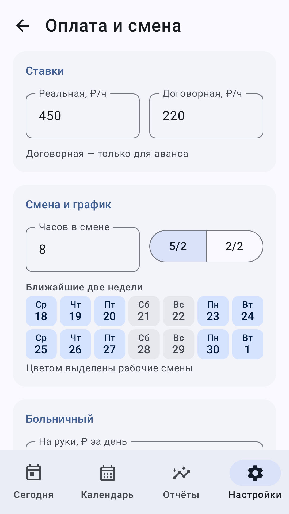
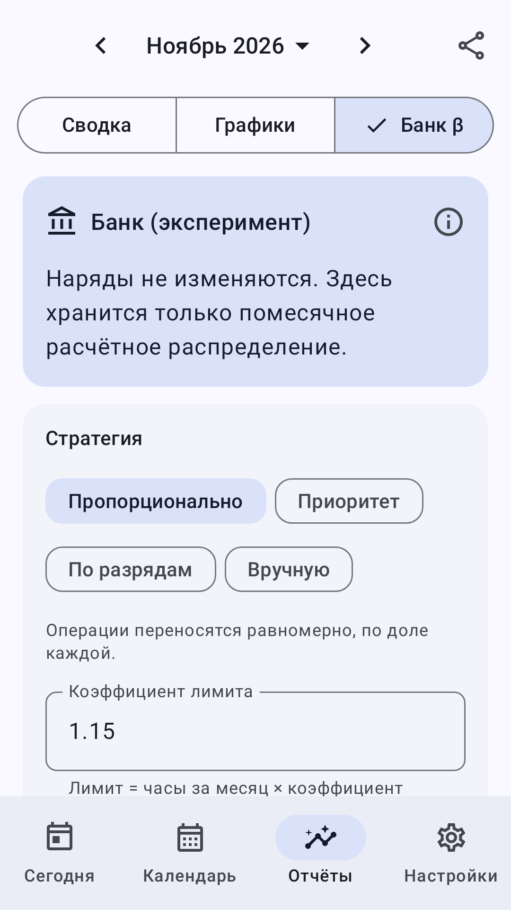
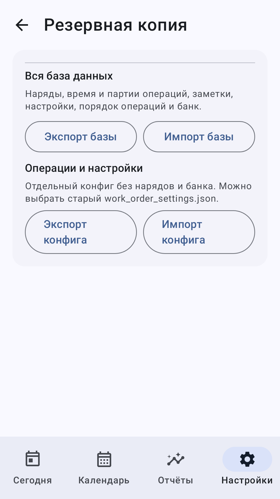

# Как пользоваться «Нарядом»

Руководство для «Наряда» 4.3 на Android. На скриншотах — демонстрационные данные.

- [Установка и первая смена](#установка-и-первая-смена)
- [Часы, операции и выработка](#часы-операции-и-выработка)
- [Календарь, график и типы дней](#календарь-график-и-типы-дней)
- [Отгулы и больничный](#отгулы-и-больничный)
- [Отчёт, зарплата и аванс](#отчёт-зарплата-и-аванс)
- [Банк нормо-часов](#банк-нормо-часов)
- [Виджеты и Wear OS](#виджеты-и-wear-os)
- [Резервная копия и перенос данных](#резервная-копия-и-перенос-данных)

## Установка и первая смена

Скачайте телефонную версию для Android 8 или новее. [Скачать APK 4.3](https://github.com/Levug/android-workorder/releases/download/v4.3/WorkOrder-4.3.apk) · [Открыть в RuStore](https://www.rustore.ru/catalog/app/ru.workorder).

При совпадении пакета `ru.workorder` и подписи Android устанавливает обновление поверх приложения с сохранением данных. Для перехода со старого приложения с другим пакетом воспользуйтесь [резервной копией](#резервная-копия-и-перенос-данных).

1. Откройте **«Сегодня» → «Записать часы»**. Укажите, сколько отработали, и нажмите **«Сохранить»**. Чтобы изменить время, нажмите на число часов в карточке дня.
2. Если ведёте учёт выработки, нажмите **«Добавить операцию»**. При пустом каталоге сразу откроется форма. Введите название, разряд и норму времени на одну штуку. Полчаса на деталь — это 0,5 ч. Нажмите **«Сохранить и указать количество»**.
3. Для расчёта зарплаты откройте **«Отчёты» → «Указать ставку»**. Часы и операции можно записывать сразу, а ставку добавить позже.

  
  

## Часы, операции и выработка

**Часы** — сколько времени отработано. **Нормо-часы** — сколько времени полагается на выполненные операции по норме. Приложение умножает количество штук на норму каждой операции и складывает результаты.

Например, за 8 часов вы сделали 20 деталей с нормой 0,5 ч на штуку. Получилось 10 нормо-часов и 125% выработки за день. Выработка в наряде — нормо-часы, поделённые на отработанные часы и умноженные на 100. Если отработанные часы равны нулю, процент не показывается.

### Как записывать и исправлять партии

- В окне операции кнопка **«+5»** сразу добавляет пять штук. Для другого количества введите число и нажмите **«Добавить»**. **«Закрыть»** вернёт вас в наряд.
- Если часов ещё нет, первая партия создаст смену со стандартной длительностью из настроек. Перед записью приложение покажет эту длительность.
- **«Быстро добавить»** повторяет последнее количество выбранной операции одним касанием. Удержание кнопки открывает ввод количества. Размеры кнопок **«+N»** задаются в **«Настройки → Эксперименты → Быстрые партии»**.
- **«Сводка»** показывает сумму за день по каждой операции. **«Журнал»** показывает отдельные партии и время записи. Случайно добавленную партию можно отменить, а удалённую запись — вернуть по кнопке **«Вернуть»**, пока она видна на экране.
- Чтобы уменьшить итог, введите число и нажмите **«Списать»**. В журнале появится отрицательная запись, а исходная партия сохранится.

### Как устроен каталог

Откройте **«Настройки → Каталог операций»**. Если операция больше не нужна в ежедневном списке, отправьте её в архив. Она исчезнет из выбора на телефоне и часах, а старые записи останутся. При удалении операции её записи удалятся из журнала. Приложение покажет, сколько записей и нарядов затронет удаление.

Для нормо-часов используется текущая норма времени из каталога. Если изменить её у существующей операции, пересчитаются и старые записи. Если новую норму нужно применять только с определённого дня, создайте отдельную операцию и отправьте старую в архив.

## Календарь, график и типы дней

В **«Календаре»** нажмите на дату, чтобы открыть её наряд. Стрелки меняют месяц, касание названия месяца открывает выбор даты. Тепловая шкала помогает увидеть, на какие дни пришлось больше часов.

График задаётся в **«Настройки → Оплата и смена»**. В **5/2** выходными считаются суббота и воскресенье. Для **2/2** укажите первый из двух рабочих дней цикла. От этой даты приложение повторяет два рабочих дня и два выходных. Проверьте результат на календаре ближайших двух недель. Праздники по производственному календарю отметьте вручную.

Тип дня меняется в карточке наряда. Нажмите на подпись **«По графику»** или текущий тип дня.

| Тип дня | Что меняется |
| --- | --- |
| **По графику** | Приложение определяет рабочий или выходной по настройкам. Записанная смена в выходной считается по двойной ставке. |
| **Рабочий** | Дата считается обычным рабочим днём даже в выходной по графику. |
| **Праздник** | Записанные часы оплачиваются по двойной ставке, день исключается из обычной нормы по графику. |
| **Выход за отгул** | Записанные часы пополняют баланс отгулов. В зарплату за эту смену они не входят. |
| **Отгул** | Часы дня списываются из баланса и учитываются по обычной ставке. На пустой дате ставится стандартная длительность смены. |
| **БС** | День без сохранения содержания исключается из автоматической нормы. Оставьте часы пустыми, если не работали. Если часы уже записаны, приложение продолжит учитывать их как обычные. |
| **Больничный** | Дата исключается из рабочих часов, выработки, зарплаты и автоматической нормы. Оценка пособия показывается отдельно. |
| **Ручной** | Задайте часы по обычной ставке, часы по повышенной ставке и коэффициент. Например, 6 ч по ×1 и 2 ч по ×1,5 дадут 8 ч смены и оплату как за 9 ч по ставке. |

На пустой дате заметка, специализация и большинство типов дня сохраняются как план без отработанных часов. Исключения — отгул на весь день и ручной режим, в котором часы вводятся сразу. Тип дня может повлиять на норму и прогноз даже до записи часов.

Чтобы планировать работу по участкам или задачам, включите **«Настройки → Эксперименты → Специализация дня»**. В наряде появится поле специализации, а кнопка **«Показать специализации»** в календаре переключит подписи дат с часов на план.

## Отгулы и больничный

### Как работает баланс отгулов

Баланс общий для всех месяцев. К остатку из **«Настройки → Оплата и смена → Отгулы»** прибавляются часы «Выходов за отгул», затем вычитаются взятые отгулы.

- Чтобы **накопить** часы, отметьте день как **«Выход за отгул»** и запишите фактически отработанное время.
- Чтобы **взять день целиком**, выберите **«Отгул»**. Если смена уже была заполнена, проверьте указанное число часов.
- Чтобы **взять часть смены**, оставьте тип **«По графику»** или **«Рабочий»**. В окне часов нажмите **«Добавить часы отгула»**, заполните «Отработано» и «Отгул к этому дню». При 4 ч работы и 4 ч отгула в фонд месяца попадёт 8 ч, из баланса спишется 4 ч.

### Как отметить больничный

Выберите тип **«Больничный»** на каждой дате периода, включая выходные, если они входят в больничный. Ранее внесённые часы и операции на этих датах сохраняются. Они вновь учитываются после смены типа дня.

Если нужна оценка выплаты, откройте **«Настройки → Оплата и смена → Больничный»** и введите ожидаемую сумму на руки за календарный день. Приложение умножит её на число отмеченных дней в выбранном месяце. Нулевая сумма оставляет в отчёте только число дней. Если период переходит из одного месяца в другой, оценка распределится по датам. Она отображается отдельно от зарплаты в отчёте, PDF и CSV.

## Отчёт, зарплата и аванс

На вкладке **«Отчёты»** выберите месяц. **«Заработано»** — расчёт по отмеченным сменам. **Прогноз** дополняет их ещё не заполненными рабочими днями по графику со стандартной длительностью смены.

### Где задать ставки и норму

В **«Настройки → Оплата и смена»** поле **«Реальная, ₽/ч»** задаёт ставку для расчёта зарплаты. Поле **«Договорная, ₽/ч»** применяется к авансу. Сохраните изменения кнопкой внизу. Ставки и график общие, поэтому их изменение может пересчитать отчёты за прошлые месяцы.

**Норма месяца** по умолчанию получается из графика и стандартной длительности смены с учётом типов дней. Если вам выдали другую норму, нажмите **«Изменить»** рядом с нормой в «Сводке» и введите часы для этого месяца. Пустое поле вернёт автоматический расчёт.

### Из чего складывается сумма

- Часы обычных смен и задержки в пределах месячной нормы идут по ×1. Оставшиеся часы задержек идут по ×2. Например, если до нормы не хватает 2 ч и накопились 3 ч задержек, 2 ч оплачиваются по ×1, ещё 1 ч — по ×2.
- Часы в выходной по графику или с типом «Праздник» идут по ×2. В ручном режиме действуют часы и коэффициент, заданные для этой даты.
- В аванс входят часы с 1-го по 15-е число включительно. По умолчанию учитываются обычные часы в пределах длительности смены за день, по договорной ставке. Эксперимент **«Аванс с переработками»** позволяет заполнить недостающие часы переработками и выходами в первой половине месяца в пределах её нормы по графику.
- **Вторая часть** — полная сумма по рабочим часам за вычетом аванса. Раскройте **«Из чего складывается»**, чтобы увидеть часы и коэффициенты, из которых получился расчёт.

Вкладка **«Графики»** показывает фактические нормо-часы по дням до переносов в банк. Коснитесь столбика и нажмите **«Открыть день»**, чтобы проверить запись. Меню **«Поделиться отчётом»** сохраняет выбранный месяц в PDF или CSV. Для сверки прошлых периодов сохраните файл после закрытия месяца.

## Банк нормо-часов

**«Банк β»** в отчётах переносит количество штук между отчётами разных месяцев. Наряды и журнал сохраняют фактически записанные операции. Распределение влияет на месячные нормо-часы, выработку и экспорт. Сумма зарплаты в приложении рассчитывается по часам смен, ставкам и типам дней.

Лимит банка — учтённые часы месяца × коэффициент. При 160 ч и коэффициенте 1,15 лимит составит 184 нормо-часа. Если записано 190 нормо-часов, приложение стремится убрать разницу в 6 нормо-часов. Переносятся целые штуки, поэтому итог может отличаться от лимита. Если за следующий месяц выработка ниже лимита, можно взять штуки из накопленного остатка. Банк и норма часов для оплаты — два отдельных показателя.

1. Откройте **«Отчёты» → «Банк β»** и проверьте выбранный месяц.
2. Выберите стратегию. **«Пропорционально»** распределяет перенос по операциям, **«Приоритет»** сначала откладывает младшие разряды и добирает старшие, **«По разрядам»** использует доли, которые вы зададите. Сохраните изменения коэффициента и долей, затем нажмите **«Рассчитать и применить»**. Повторный расчёт заменяет распределение за выбранный месяц.
3. Для ручного ввода выберите **«Вручную»**. **«+1 в банк»** откладывает штуку из месячного итога, **«−1 в наряд»** забирает штуку из банка в месячный отчёт. Если требуется сразу несколько штук, нажмите на число между кнопками.
4. Чтобы убрать переносы за выбранный месяц, нажмите **«Сбросить распределение»**. Если хотите видеть только фактические операции, выключите **«Настройки → Эксперименты → Банк нормо-часов»**. Распределение сохранится и снова применится при включении.

Месячная выработка может отличаться от дневной. В неё входят нормо-часы с учётом банка, если он включён, и часы из фонда месяца. Фонд учитывает оплачиваемые отгулы и исключает больничные и выходы за отгул.

## Виджеты и Wear OS

### Виджеты телефона

На домашнем экране Android удерживайте свободное место, откройте **«Виджеты»** и найдите **«Наряд»**. **«Сегодня»** и **«Компактный»** показывают текущую смену, а кнопка добавления открывает выбор операции. **«Календарь»** показывает текущий месяц. Нажмите на число, чтобы открыть наряд за эту дату. Доступные размеры зависят от лаунчера.

### Часы Wear OS

Установите APK 4.2 на сопряжённые часы через ADB. Например, после подключения к часам выполните `adb -s <адрес-часов> install -r WorkOrder-4.2-watch.apk`. [Скачать APK для Wear OS](https://github.com/Levug/android-workorder/releases/download/v4.2/WorkOrder-4.2-watch.apk).

На телефоне откройте **«Настройки → Часы Wear OS»**, включите **«Связь с часами»** и нажмите **«Проверить связь»**. На часы передаётся каталог доступных операций и размеры быстрых партий. Записи, сделанные без связи, остаются на часах в очереди и приходят в наряд за дату добавления после восстановления связи. Если очередь не ушла, проверьте подключение и откройте «Наряд» на телефоне. Перед переносом базы дождитесь, когда очередь опустеет.

## Резервная копия и перенос данных

Откройте **«Настройки → Резервная копия»**.

| Что нужно перенести | Что выбрать |
| --- | --- |
| Полную историю, часы, операции, журнал, настройки и банк | **«Экспорт базы»** на старом телефоне. Перенесите JSON-файл на новый. Там нажмите **«Импорт базы»**, проверьте число записей и подтвердите замену. |
| Только каталог операций и настройки | **«Экспорт конфига»** и **«Импорт конфига»**. Одноимённые операции обновятся, новые добавятся. Записи в нарядах сохранятся, а изменение нормы операции может пересчитать нормо-часы в истории. |

Импорт полной базы заменяет данные на устройстве содержимым файла. Перед импортом приложение создаёт страховочную копию текущей базы. Чтобы сохранить её в файл, нажмите **«Сохранить базу до последнего импорта»** в том же разделе. Файлы копий содержат данные нарядов и не шифруются. Храните их в месте, доступном только вам.

[Вернуться на страницу проекта](../README.md) · [Политика конфиденциальности](../PRIVACY.md)
